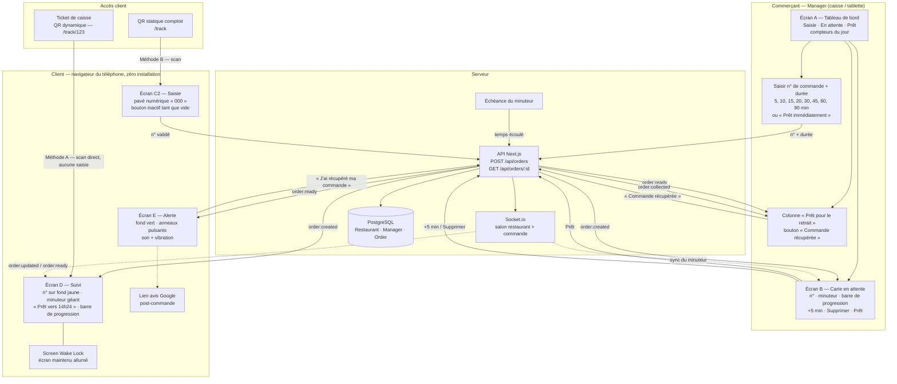
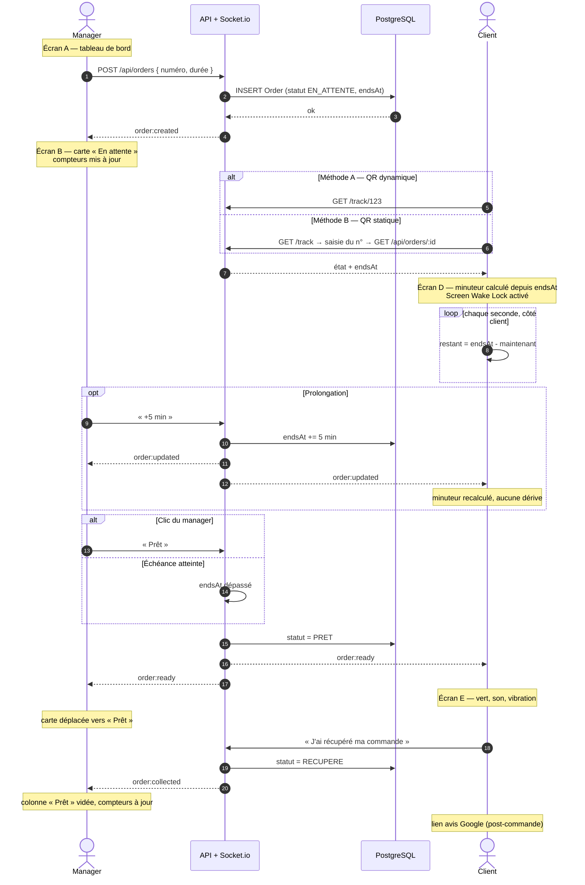
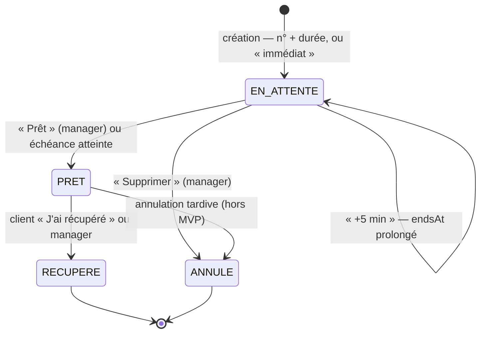
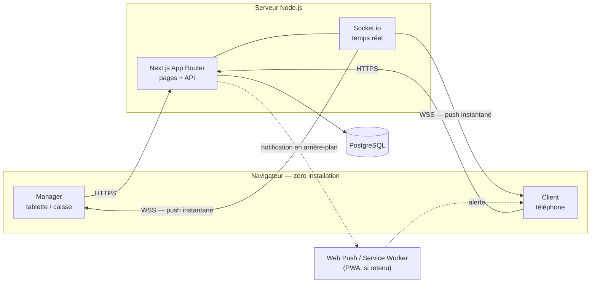

# Diagrammes — Parcours Scan&Ready (MVP V1)

> **Source unique** : [`conception-etape-0.md`](./conception-etape-0.md) (§2 Double parcours QR, §3 Parcours en 5 phases, §5 Périmètre MVP).
> **Format** : Mermaid (rendu natif GitHub / GitLab / VS Code). Une version éditable du parcours d'ensemble est fournie dans [`diagramme-parcours.drawio`](./diagramme-parcours.drawio).
> **Portée** : MVP V1 uniquement. Tout ce qui est V2 (comptes complexes, statistiques avancées, personnalisation) est exclu.

---

## 1. Vue d'ensemble du parcours

Carte des 5 écrans (A, B, C2, D, E), des deux méthodes de jonction client et des échanges avec le serveur.

**Correspondance avec la doc**

| Élément | Section source |
|---|---|
| Écran A (3 zones, pavé, durées, compteurs) | §3.1 |
| Écran B / carte en attente (+5 min, Supprimer, Prêt) | §3.2 |
| Méthode A (QR dynamique `/track/123`) | §2 |
| Méthode B (QR statique `/track` + saisie) | §2, §3.1 |
| Écran D (minuteur, heure de fin, Wake Lock) | §3.4 |
| Écran E (vert, son, vibration, clôture, couper le son) | §3.5 |
| Avis Google | §5 |

---

## 2. Séquence temps réel

L'ordre exact des échanges, du premier clic du manager à la clôture. Le minuteur client est **recalculé depuis l'heure de fin** (`endsAt`), jamais décrémenté localement de façon autoritaire : c'est ce qui garantit la synchronisation avec la carte manager et évite la dérive quand le téléphone se met en veille.

---

## 3. Cycle de vie d'une commande

Les statuts sont ceux imposés par le prompt technique : `EN_ATTENTE`, `PRET`, `RECUPERE`, `ANNULE`.

---

## 4. Vue technique (stack de la doc, §4)

> ⚠️ Point à trancher : la doc hésite entre **Web Push (Service Worker)**, **ntfy** et **Socket.io** pour l'alerte. Socket.io seul ne réveille pas un téléphone verrouillé ; seule une notification push le fait. Ce schéma montre les deux canaux, mais un seul doit être retenu dans la spec finale.

---

## 5. Ce que ce diagramme ne couvre pas (volontairement)

- **Authentification** du manager et **multi-établissement** : non spécifiés dans `conception-etape-0.md`, à documenter avant l'implémentation.
- **Cas d'erreur** (numéro introuvable, commande expirée, deux clients sur le même numéro) : mentionnés dans le prompt technique, absents de la conception.
- **V2** : statistiques, fidélité, personnalisation graphique, intégration caisse.
